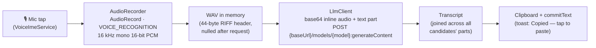
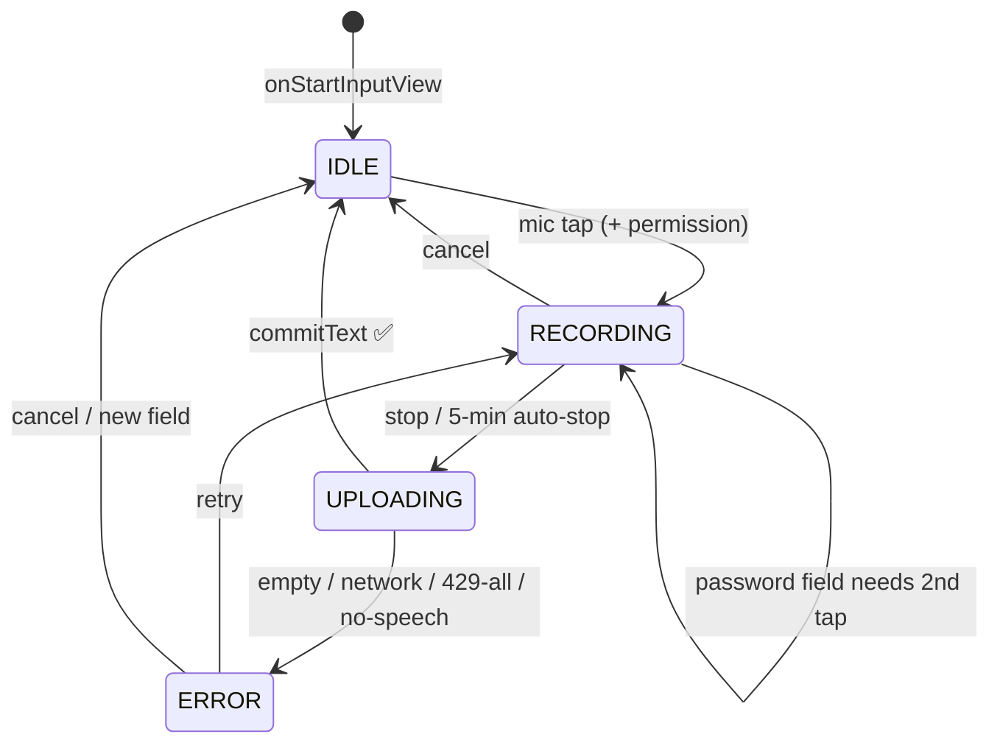

<div align="center">

# 🎙️ Voice IME

**A voice-only Android keyboard. No keys — just speak.**

Speak → record → transcribe with Gemini → paste anywhere. A single-purpose
`InputMethodService` built with Material 3 dynamic color, a live waveform hero,
and privacy-first, memory-only audio.

[](https://github.com/arvindg4u/voice-ime-android/actions/workflows/android.yml)
[](https://github.com/arvindg4u/voice-ime-android/releases)
[-3DDC84?style=flat-square&logo=android)](https://developer.android.com/about/versions/oreo)
[](https://developer.android.com/about/versions/14)
[](https://kotlinlang.org)
[](https://m3.material.io)

[Features](#-features) · [Quick start](#-quick-start) · [How it works](#-how-it-works) · [Design](#-design-system) · [Architecture](#-architecture) · [Privacy](#-privacy--security)

</div>

---

## Table of contents

- [Why Voice IME](#why-voice-ime)
- [✨ Features](#-features)
- [📸 Screenshots](#-screenshots)
- [🚀 Quick start](#-quick-start)
- [⚙️ Configuration](#️-configuration)
- [🔄 Key rotation](#-key-rotation)
- [💬 Custom prompt](#-custom-prompt)
- [🧠 How it works](#-how-it-works)
- [🎨 Design system](#-design-system)
- [🏗️ Architecture](#️-architecture)
- [🛠️ Build from source](#️-build-from-source)
- [✅ Testing](#-testing)
- [📏 Limits](#-limits)
- [🔒 Privacy & security](#-privacy--security)
- [❓ FAQ & troubleshooting](#-faq--troubleshooting)
- [🤝 Contributing](#-contributing)
- [🙏 Acknowledgments](#-acknowledgments)

---

## Why Voice IME

Most keyboards bolt voice on as an afterthought — a tiny mic icon buried in a
grid of keys. **Voice IME inverts that.** The entire keyboard *is* the
microphone:

| Traditional keyboard | Voice IME |
| -------------------- | --------- |
| 40+ keys, mic hidden in a corner | Zero keys — one transport bar |
| Typing-first, voice as fallback | Voice-first, voice-only |
| Opaque "listening…" spinner | Live 48-bar waveform + explicit state dot |
| Audio uploaded to opaque endpoints | WAV → Gemini `generateContent` you configure, memory-only |

> **Thirty-second pitch:** install the APK, paste a Gemini API key, select
> Voice IME as your keyboard — then tap 🎙️ and talk in any app.

---

## ✨ Features

- **Voice-only input** — no QWERTY. Tap mic → speak → transcript lands in the
  text field via clipboard + `commitText` (toast: *"Copied — tap to paste"*).
- **Live waveform hero** — 48-bar `WaveformView`, invalidates only on amplitude
  change > 0.02 (~30 fps max, zero per-frame allocation).
- **Explicit state system** — status dot (idle outline · recording primary ·
  uploading tertiary · error red) + transport pill + status text. No guessing.
- **Smart transport bar** — single-line pill with state, ghost cancel, clip
  badge, and error-only retry row.
- **Clipboard history** — every transcript saved; badge count, popup, and a
  dedicated history activity with pin/delete.
- **Live transcript hardening** — session-id capture + final accumulator so
  partial results never clobber the final text.
- **Password-field guard** — password fields require a **second mic tap** to
  confirm dictation. No accidental leaks.
- **Context-aware Enter** — Enter button reads `imeOptions` and labels itself
  Go / Search / Send / Next / Done / Previous (else "Enter"); commits a newline
  when no action is set. Visible in idle and error states only.
- **Multi-key rotation** — round-robin across keys with automatic 429 failover
  and even load spread.
- **User-shaped transcription** — custom system prompt (≤ 2000 chars) steers
  formatting, language, and tone — including the Settings Test button.
- **Live + batch transports** — REST `generateContent` by default, with
  WebSocket live-transport and Interactions-API routing per model, plus runtime
  fallback on transport mismatch.
- **Resilient recording** — Stop button or 10-min auto-stop; mic teardown runs
  off the UI thread so Stop never janks; granting mic permission auto-resumes a
  pending tap; blocked-mic detection hints when another app holds the mic.
- **System floating button** — Optional AccessibilityService mode shows a
  draggable mic whenever a non-password editable field has focus, with the
  same edge-peek, restore, recording pulse, state colors, and focused-cursor
  insertion pattern as the dedicated keyboard. It reuses this app's
  `AudioRecorder`, `SettingsStore`, and `LlmClient`; it does not add a second
  backend.

---

## 📸 Screenshots

> Capture on a Pixel (light + dark) at `docs/images/` and keep filenames
> stable — the table below is wired to these paths.

| Idle — tap to speak | Recording — live waveform | Uploading — transcribing | Settings |
| ------------------- | ------------------------- | ------------------------ | -------- |
|  |  |  |  |
| *Status dot outline, "Tap to speak"* | *Primary dot, 48 bars dancing, timer + Stop* | *Tertiary dot, "Sending…"* | *Base URL · keys · model · prompt · Test* |

<!-- TODO(contributor): add docs/images/ime-idle.png, ime-recording.png,
     ime-uploading.png, settings.png (1080×2400, PNG, < 500 KB each).
     Keep the 4-column table — don't add more screenshots to the README;
     longer flows belong in docs/ or the release notes. -->

---

## 🚀 Quick start

**You need:** an Android 8.0+ device and a
[Gemini API key](https://aistudio.google.com/apikey).

```bash
# Option A — grab the APK (fastest)
# 1. Open Releases → download the latest app-release.apk
#    https://github.com/arvindg4u/voice-ime-android/releases
# 2. Install on device, then follow the 4 steps below.

# Option B — CI debug artifact
# Actions → latest Android run → Artifacts → app-debug
```

**5-step setup (on device):**

1. **Install** the APK and open the **Voice IME** app.
2. **Configure** — enter **Base URL** (default
   `https://generativelanguage.googleapis.com/v1beta`), **API keys** (one per
   line), and **Model** (defaults to `gemini-3.5-transcribe-live`), then **Save**. Tap **Test**
   to verify with a 1-second 440 Hz tone.
3. **Enable keyboard** — tap **Enable keyboard**, turn on **Voice IME** in
   Android's system keyboard/input-method settings, and select it as the current
   keyboard (use the 🌐 switcher or the system keyboard switcher). The keyboard
   does not require Accessibility or notification access.
4. **Speak** — tap 🎙️ in any text field, talk, tap **Stop**. Grant microphone
   permission when prompted (a pending tap auto-resumes after grant).
5. **Optional floating button** — tap **Enable floating button** and review the
   in-app disclosure before opening Android Accessibility settings. If Android
   blocks a sideloaded install, allow restricted settings for Voice IME first
   (see [Android 16 permissions](docs/android-16-permissions.md)). The standard
   keyboard works even when this optional service is off.

See [`docs/floating-button.md`](docs/floating-button.md) for the accessibility
boundary, runtime flow, and device-testing notes.

---

## ⚙️ Configuration

All settings live in the **Voice IME** settings activity and persist in
`EncryptedSharedPreferences`.

| Field | Default / example | What it does |
| ----- | ----------------- | ------------ |
| **Base URL** | `https://generativelanguage.googleapis.com/v1beta` | Gemini-compatible endpoint. Swap for a proxy or gateway without rebuilding. |
| **API keys** | one key per line | Round-robin pool with 429 failover (see below). Keys are never logged. |
| **Model** | `gemini-3.5-transcribe-live` | Dedicated Live transcription model by default. Live-marker models route to the existing BidiGenerateContent WebSocket; batch-transcription models route to the existing Interactions API. |
| **Custom prompt** | blank (disabled) | System instructions (max 2000 chars) appended under a *"User preferences:"* heading to every request, including Test. |
| **Smart mode** | off | Model-specific enhanced transcription path where supported. |

---

## 🔄 Key rotation

Put one API key per line — the client spreads load instead of hammering key #1:

```text
keys = [k1, k2, k3], cursor starts at 0
request → try k1 → 429? → try k2 → success → cursor = (1 + 1) % 3 = 2
next request starts at k3 …
all keys 429'd → "Rate limited on all keys — retry later"
401 / other non-429 → fail immediately (never burns the other keys)
```

- **Order:** round-robin from the cursor, wrapping with modulo.
- **429:** advance to the next key automatically within the same request.
- **Success:** cursor advances to `(usedIndex + 1) % n` for even spread.
- **Non-429 (e.g. 401 bad key):** surfaces immediately — a bad key must not
  consume quota on good keys.

---

## 💬 Custom prompt

The **Custom prompt** field shapes every transcription:

| Goal | Prompt to paste |
| ---- | --------------- |
| Formatting | `Add punctuation and paragraph breaks.` |
| Hinglish keep-as-is | `Keep Hinglish words as-is, don't translate them.` |
| Hindi script | `Reply in Hindi script (Devanagari).` |
| Combo | `Keep Hinglish as-is, add punctuation, reply in Hindi script.` |

> Leave it blank to disable. The prompt is sent as `systemInstruction`, so it
> also steers the **Test** button tone — a handy preview before you dictate.

---

## 🧠 How it works

### Pipeline



1. **Capture** — `AudioRecorder` opens `AudioRecord` with `VOICE_RECOGNITION`,
   16 kHz mono 16-bit PCM. Amplitude callbacks drive the waveform (~30 fps);
   PCM chunks can additionally stream to the live transport.
2. **Encode** — PCM → WAV in memory (pure `pcmToWav`, JVM-tested). A built-in
   1 s 440 Hz `testToneWav()` powers the Settings **Test** button.
3. **Transcribe** — `LlmClient` (OkHttp; 15 s connect / 90 s read+write)
   POSTs `{contents:[{parts:[{inlineData:{mimeType:audio/wav,data:base64}},
   {text:…}}]}]}` with `x-goog-api-key`. Transport routing:
   live-marker models → `BidiGenerateContent` WebSocket (`LiveSocket`);
   batch models → Interactions API (`GeminiTransports`); everything else →
   REST, with runtime fallback on transport mismatch.
4. **Deliver** — transcript joined from all candidates' parts → written to
   `ClipboardStore` history → copied to clipboard → `commitText` into the
   editor. `LiveSessionGuard` + `FinalAccumulator` protect the live tail from
   overwriting the final text.
5. **Stop** — Stop button or 5-min auto-stop; mic teardown runs off the UI
   thread so Stop never janks.

### State machine



---

## 🎨 Design system

**One memorable element:** the live waveform hero. Everything else is chrome
that gets out of the way.

| Token / element | Value |
| --------------- | ----- |
| Theme | Material 3 dynamic color — wallpaper-derived on Android 12+ (`values-v31`), static M3 baseline fallback below |
| Status dot | outline = idle · primary = recording · tertiary = uploading · red = error (`ime_status_dot.xml`) |
| Waveform | 48 symmetric rounded bars around a center line; idle sine ripple; recording levels pushed via `setAmplitude` |
| Transport bar | single-line pill: state label + mic/stop icon · ghost cancel · clip-history badge · error-only retry row |
| Enter button | idle/error only; label mirrors `imeOptions` action (Go / Search / Send / Next / Done / Previous / Enter) |
| Back button | returns to the previous keyboard |
| Perf budget | invalidate only on Δ amplitude > 0.02, ≥ 33 ms apart; zero per-frame allocation (cached `BarGeometry`, reused `RectF`); pulse math in JVM-testable `ImeLayoutPolicy.idleRippleFraction` |

**Design principles:**

- **State is always visible** — dot + pill + text agree; no silent spinners.
- **One thumb** — mic, stop, cancel, and Enter are reachable without stretching.
- **Calm errors** — error state keeps the transcript context, offers Retry /
  Settings inline, and never loses the last clip snapshot.

---

## 🏗️ Architecture

**Stack:** Kotlin · `InputMethodService` · Coroutines · OkHttp · Material 3 ·
minSdk 26 / targetSdk 34 · Gradle Kotlin DSL · JDK 17.

```text
app/src/main/java/com/voiceime/      # 20 sources
├── VoiceImeService.kt               # IME lifecycle, state machine, transport UI
├── AudioRecorder.kt                 # AudioRecord capture → WAV, levels, 10-min cap
├── LlmClient.kt                     # REST transcription + key rotation + fallback
├── LiveSocket.kt                    # WebSocket live transport
├── GeminiTransports.kt              # transport routing (live / interactions / REST)
├── LiveSessionGuard.kt              # live-session lifecycle guard
├── FinalAccumulator.kt              # final-transcript accumulator
├── WaveformView.kt                  # 48-bar canvas view (stateless service-owned)
├── ImeLayoutPolicy.kt               # bar geometry + idle ripple (JVM-tested)
├── ClipboardStore.kt / ClipboardEntry.kt / ClipboardPolicy.kt
│                                    # history persistence, model, retention rules
├── ClipboardHistoryActivity.kt      # history UI (pin / delete)
├── SettingsActivity.kt              # Base URL · keys · model · prompt · Test
├── FloatingMicAccessibilityService.kt # Focus-driven system overlay host
├── FloatingMicView.kt               # Deterministic overlay mic rendering
├── FloatingMicPolicy.kt             # Testable visibility/peek geometry
├── SettingsStore.kt                 # EncryptedSharedPreferences wrapper
└── MicPermissionActivity.kt         # permission grant → auto-resume pending tap

app/src/main/res/
├── layout/ime_voice_view.xml        # IME root (transport bar + waveform + states)
├── layout/activity_settings.xml     # settings form
├── layout/activity_clipboard_history.xml + item_clipboard_entry.xml
├── xml/method.xml                   # input-method declaration
└── values*/                         # M3 colors (incl. values-v31 dynamic),
                                     # dimens (incl. sw600dp), themes, strings

app/src/test/java/com/voiceime/      # 6 unit-test suites (JUnit4 + MockWebServer)
```

**CI/CD** (`.github/workflows/`): `android.yml` runs unit tests + debug APK on
every push/PR; `release.yml` builds a signed release APK on `v*` tags via
`VOICEIME_*` secrets and attaches it to the GitHub Release.

---

## 🛠️ Build from source

```bash
# Requirements: JDK 17 + Android SDK (compileSdk 34)

git clone https://github.com/arvindg4u/voice-ime-android
cd voice-ime-android

# Debug APK → app/build/outputs/apk/debug/app-debug.apk
./gradlew assembleDebug

# Unit tests
./gradlew testDebugUnitTest

# Signed release (needs VOICEIME_KEYSTORE_FILE / VOICEIME_STORE_PASSWORD /
# VOICEIME_KEY_ALIAS / VOICEIME_KEY_PASSWORD — CI provides these)
./gradlew assembleRelease
```

> The debug APK is CI-built and **not Play-ready** — no release signing, no
> Play Console metadata.

---

## ✅ Testing

| Layer | How |
| ----- | --- |
| Unit | `./gradlew testDebugUnitTest` — focused JVM suites cover `AudioRecorder`, `LlmClient` (MockWebServer incl. 429-rotation and raw WebSocket finalization-frame checks), `ClipboardStore`, `ClipboardPolicy`, `ImeLayoutPolicy`, `LiveSessionGuard`, and `FloatingMicPolicy` |
| Manual Test button | Settings → **Test** sends the 440 Hz tone through the full pipeline with your keys/model/prompt |
| Manual IME flows | fresh field → dictate → commit · password double-tap · airplane-mode error → retry · rotate keys with an invalid-first key · 10-min auto-stop |

`WaveformView` itself is framework-bound (no unit tests by design) — its math
lives in `ImeLayoutPolicy` where CI can reach it, and the compile gate keeps
the view honest.

---

## 📏 Limits

- **Recording cap: 10 min.** At 16 kHz mono 16-bit (32 KB/s ≈ 1.9 MB/min WAV,
  ×4/3 base64 ≈ 2.6 MB/min JSON) a full clip is ≈ 26 MB if sent as one inline
  request. The default Live Transcribe transport streams PCM instead, and its
  documented session limit is 10 minutes; the local cap is shared by both
  streaming and one-shot recorder flows.
- **Network-bound** — transcription needs connectivity; offline shows an
  explicit network error with retry.
- **Debug distribution** — install via APK/CI artifact; not on Google Play.

---

## 🔒 Privacy & security

- **Memory-only audio** — recordings live in RAM and are nulled after each
  request. Nothing is written to disk.
- **Encrypted keys** — API keys in `EncryptedSharedPreferences`
  (`security-crypto`); never logged (requests log host/model/size only).
- **No backup, no screenshots** — `android:allowBackup=false`; settings sets
  `FLAG_SECURE`.
- **Sensitive-key protection** — the API-key input is protected from obscured
  taps and marked accessibility-data-sensitive on Android 14+; system
  accessibility tools remain supported.
- **Explicit consent** — `RECORD_AUDIO` is requested at use time; password
  fields need a deliberate second tap and are never eligible for the floating
  button. The optional floating mode requires explicit Accessibility-service
  opt-in.
- **Minimal permissions** — only `INTERNET` + `RECORD_AUDIO` are declared; no
  notification posting or notification-listener access is used. The optional
  floating service is protected by `BIND_ACCESSIBILITY_SERVICE`, receives
  focused-editor, selection, and window-transition events (not text-change
  events), and rejects password fields. It may read the
  current non-password field and selection solely to preserve the insertion
  point; existing field text is not sent to the transcription API or logged.
  No contacts, location, or storage access.

> Found a vulnerability? Please open a **private security advisory** on GitHub
> instead of a public issue.

---

## ❓ FAQ & troubleshooting

<details>
<summary><strong>"No API key — open Settings"</strong></summary>

The key pool is empty. Open the Voice IME app → paste at least one Gemini API
key (one per line) → Save → Test.
</details>

<details>
<summary><strong>"Rate limited on all keys — retry later"</strong></summary>

Every key returned 429. Wait a minute, or add another key on a different
project to widen the pool. A 401 (bad key) fails fast instead — check that key.
</details>

<details>
<summary><strong>Mic doesn't start / "Mic seems blocked"</strong></summary>

Another app is holding the microphone (calls, recorders, assistants). Close it
and tap mic again. If permission was denied, re-grant it — a pending tap
auto-resumes after grant.
</details>

<details>
<summary><strong>"No speech detected" / empty transcript</strong></summary>

Speak closer/louder, reduce background noise, and check the waveform moves
while recording. Very short taps (< ~0.5 s) may capture no audio.
</details>

<details>
<summary><strong>Floating mic doesn't appear / Accessibility access is blocked</strong></summary>

The optional floating button needs the **Voice IME floating button** service
turned on in Android Accessibility settings. If Android 13+ blocks it for an
APK installed from outside a trusted app store, first open **Settings → Apps →
Voice IME → ⋮ → Allow restricted settings**, authenticate if asked, then return
to **Enable floating button** and turn on the service. OEM menu names vary.
Only do this if you trust the app. The standard keyboard continues to work
without the floating service. See [Android 16 permissions and setup](docs/android-16-permissions.md).
</details>

<details>
<summary><strong>Notifications are disabled or not working</strong></summary>

Voice IME currently does not post notifications and does not read other apps'
notifications. It therefore does not request `POST_NOTIFICATIONS` or
Notification access. This is unrelated to enabling the optional Accessibility
service for the floating mic.
</details>

<details>
<summary><strong>Keyboard doesn't appear in the list</strong></summary>

Open the Voice IME app → **Enable keyboard** → enable Voice IME under Android's
**Keyboard / On-screen keyboard / Input methods** settings, then select it with
the system keyboard switcher. This is separate from Accessibility settings;
notification access is not required.
</details>

<details>
<summary><strong>Transcript went to the wrong field</strong></summary>

The IME snapshots the latest clip on every input start — open
clipboard-history from the badge to re-paste any recent transcript.
</details>

---

## 🤝 Contributing

Issues and PRs are welcome — this is a small, focused codebase and it shows.

```bash
# Standard loop
./gradlew testDebugUnitTest   # must stay green
./gradlew assembleDebug       # must build
```

- **Issues:** include device, Android version, app version (`1.6.1`), model,
  and the exact toast/error string.
- **PRs:** keep the voice-only concept; match M3 dynamic-color tokens; add or
  update unit tests for logic changes; keep functions focused and state explicit.
- **No-goes:** new permissions, disk persistence of audio, unencrypted key
  storage, verbatim copies from other keyboards.

---

## 🙏 Acknowledgments

IME and audio patterns studied from
[futo-org/android-keyboard](https://github.com/futo-org/android-keyboard)
(FUTO Source First License 1.1-kb) — all code reimplemented, no verbatim copy.

Transcription by the [Gemini API](https://ai.google.dev) (`generateContent`
with inline audio). Built with Material 3, OkHttp, and Kotlin Coroutines.
